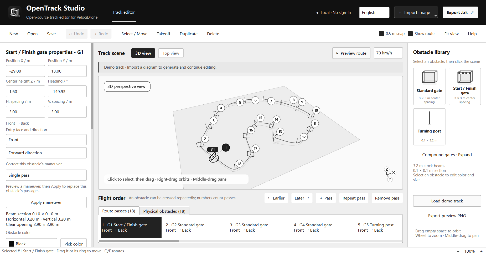

# OpenTrack Studio

English | [简体中文](README.zh-CN.md)


**An open-source C++/Qt track editor designed for the VelociDrone FPV simulator.** Import a race diagram to generate a local draft, review the gate order, entry/exit faces and wrapping direction in 3D, then export a native VelociDrone `.trk` file.

**English and Simplified Chinese UI. No application account or login.** Track projects stay on your computer. Diagram recognition runs locally; optional photograph analysis sends selected images to the configured official DeepSeek API only after an explicit Generate action.

[Download Windows previews](https://github.com/123-fpv/opentrack-studio/releases) · [Contribute](CONTRIBUTING.md) · [License](LICENSE) · [中文使用说明](docs/quickstart.md)



## From an image to a VelociDrone track

1. Drag a clear PNG/JPG/BMP track diagram into the image box, 3D view or overhead view. A single diagram generates a local draft automatically.
2. Inspect the numbered passes and arrows. Check the entry face, exit face, height and side of each wrap; correct uncertain results before export.
3. Set the independent takeoff grid and save the editable `.otproj` project.
4. Export `.trk`, place it in your Windows Documents folder, and use **Track Editor → Import Track** in VelociDrone. Verify the scene, collisions and actual flight in the simulator.

This is a **VelociDrone-compatible editor**, not a replacement simulator and not an official VelociDrone product. The native format adapter is independently implemented. Game models, textures, executables, databases, private user diagrams and API credentials are not included.

Clear dark-frame diagrams with a magenta racing line support standard gates, double/triple gates, ladders, cubes and stacked cubes. Recognition uses directed line tracing and occlusion evidence; it is not a guarantee for every image style, screenshot or photograph. Ambiguous depth and hidden geometry still require review. Optional multi-photo AI drafts are a separate workflow, not a surveyed reconstruction.

## Editing and routes

- English / 简体中文 language selection with a local preference; user track names and content remain unchanged. `--lang en` and `--lang zh` can select a language at startup.
- Solid gray 3D ground. Reference images remain optional overhead references and are not placed on the 3D floor.
- Click once to select a component and its halo; drag the selected component on a second press. Right-drag or drag empty space to orbit, middle-drag to pan, and use the wheel to zoom.
- Physical structures and ordered passes are separate. One ladder can be traversed at different levels without duplicating its beams.
- Actual entry/exit faces and progressive wraps, including climbing/descending around an upright, variable-height linked-gate passages, and roof-to-side gravity passages. The current recognized route is the default action preview.
- Model-clearance checks preserve actual crossings, directions and essential T controls. Ordinary fitted samples stay in the project; only real passes and essential T controls become native checkpoints.
- Default frame-cell centreline spacing is 3×3 m. Beams are 3.2 m long with a 0.1×0.1 m section; the clear aperture is 2.9×2.9 m. Turning pillars default to 0.1×0.1×3.2 m.
- Independent takeoff position, base height and heading. No landing point is created by default. Components have independent RGB colors mapped to supported native block colors on export.

Start with the original synthetic [threading example](examples/threading-demo.otproj). Save `.otproj` to retain all fitted guides and offsets: `.trk` stores simulator objects and checkpoint constraints, not the entire preview curve. Advanced closed-circle actions are separate from progressive wraps.

The route preview is geometry, not flight dynamics or competition validation. A successful import or a clearance check does not prove a full course is flyable. See the [format evidence](docs/format.md), [validation record](docs/validation.md), [English quick start](docs/quickstart.en.md) and [third-party notices](THIRD_PARTY_NOTICES.md).

## Build and test

Windows x64, Visual Studio 2022 C++ tools, CMake and Qt 6.8.3 MSVC x64 are required. Application code and local recognition are C++; Python is only a development-tool dependency of the Qt installer.

```powershell
cmake -S . -B D:/CodexWork/OpenTrackStudio/build -DCMAKE_PREFIX_PATH="C:/Qt/6.8.3/msvc2022_64"
cmake --build D:/CodexWork/OpenTrackStudio/build --config Release
ctest --test-dir D:/CodexWork/OpenTrackStudio/build -C Release --output-on-failure
```

Use another data directory if D: is unavailable. The native track codec uses Windows BCrypt. Package a Release build with:

```powershell
./scripts/package.ps1 -QtDir "C:/Qt/6.8.3/msvc2022_64" -BuildDir D:/CodexWork/OpenTrackStudio/build -OutputDir D:/CodexOutputs/OpenTrackStudio-Windows
```

The output must be a new or empty directory. Packaging deploys dynamic Qt libraries, required plugins, the redistributable Windows runtime and license notices. Release downloads include application source; the unmodified QtBase source archive is supplied separately. See [licensing](docs/licensing.md).

## Open development and copyleft

**Anyone can fork, modify, report issues, translate and submit pull requests.** Maintainers review PRs before merging; a public repository does not grant everyone direct write access to the main branch. See [CONTRIBUTING.md](CONTRIBUTING.md).

Beginning with **0.1.7**, the application and new contributions are **GPL-3.0-or-later**. Distributors of covered modified/derived software must provide corresponding source under GPL. Earlier MIT permissions through 0.1.6 are preserved in [NOTICE](NOTICE) and the archived license; they do not cover new GPL changes. Qt and other dependencies retain their own terms.

Independently created user tracks and photographs do not become GPL simply because this editor processes them. Private use and network-only operation have different obligations from distribution; see the [license summary](docs/licensing.md). Commercial use is allowed under the license. VelociDrone is a separate product and this project is not affiliated with its publisher.
