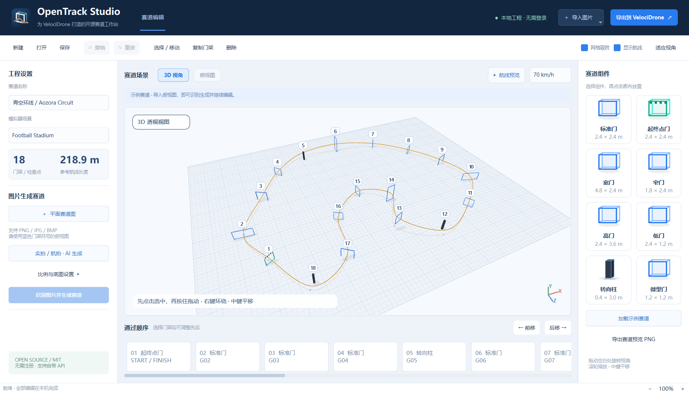

# OpenTrack Studio


用图片搭建 FPV 赛道的 C++ 桌面编辑器。导入俯视赛道图后，程序在本地自动识别蓝色门架符号；也可选择实拍或航拍照片，通过官方 AI API 生成待确认的草稿。在默认的 3D 场景中校对位置、高度和通过顺序，再导出供 VelociDrone 导入的 `.trk` 文件。

**无需应用账号登录，工程保存在本机。** 蓝色门架图识别完全在本地运行；可选的实拍 AI 功能仅在点击“生成草稿”后，将选定照片发送到 DeepSeek 官方 API。界面、图标、示例赛道和实现代码独立编写，源码采用 MIT 许可证。



## 当前功能

- 默认打开可编辑的 3D 场景，可旋转视角、平移、缩放，也可切换到俯视图。
- 导入图片后自动在本地识别门架，生成可撤销、可修改的赛道草稿。
- 可选实拍/航拍 AI 草稿：最多选择 8 张照片，补充已知门宽及起点、方向、门序说明，预览确认后再应用。
- 在场景中摆放、选择、拖动、旋转门架，调整尺寸和中心高度。
- 选中门架后显示属性；比例和底图高级设置默认收起。
- 按通过顺序查看门架，显示平滑路线和几何路径长度。
- 将完整工程保存为 `.otproj`，底图随工程嵌入。
- 导入、导出 VelociDrone `.trk`；新建赛道支持标准门、起终点门和转向柱。

本地符号识别面向清晰、平整的赛道设计图。照片、透视图和包含完整软件界面的截图，可能产生漏检或误检；建议先裁出赛道区域。图片通常无法确定真实高度、门架方向及交叉处的通过顺序，这些参数需要校对。详细操作见 [使用说明](docs/usage.md)。

实拍 AI 功能使用固定官方端点 `https://api.deepseek.com` 和 `deepseek-flash` 模型，需要用户自己的 API 密钥；可选择保存到 Windows 凭据管理器。只有明确点击生成才发送缩放后的照片，生成后先预览，再决定是否应用。已知尺寸、视角重叠和清楚的飞行顺序说明有助于生成草稿；结果仍需校对，不属于测绘或摄影测量重建。

## VelociDrone 兼容状态

项目包含独立实现的原生 `.trk` 读写。**尚未完成安装版 VelociDrone 的实际导入和飞行验收。** 文件级往返测试不能替代模拟器验收；原生门架的尺寸换算也仍需实机校准。

测试范围和官方 AI 接口实测记录见 [验证记录](docs/validation.md)。

导出文件后，可依照 [VelociDrone 官方手册](https://www.velocidrone.com/desktop_manual)，将文件放入 Windows“文档”目录，再在模拟器的 Track Editor 中使用 Import Track。编辑器不直接改写模拟器数据库，也不要求模拟器账号凭据。对象支持范围和格式依据见 [格式说明](docs/format.md)。

## 构建与测试

当前目标平台为 Windows x64。需要 Visual Studio 2022 的 C++ 桌面开发工具、CMake 和 Qt 6.8.3 的 MSVC 2022 x64 组件。原生 `.trk` 加解密使用 Windows BCrypt；应用运行时不需要 Python。

在仓库目录运行，替换下面的 Qt 安装路径：

```powershell
cmake -S . -B build -DCMAKE_PREFIX_PATH="C:/Qt/6.8.3/msvc2022_64"
cmake --build build --config Release
ctest --test-dir build -C Release --output-on-failure
```

发布 Windows 程序时，需使用对应 Qt 版本的 `windeployqt` 收集动态库和插件，并附带第三方许可说明。构建过程和 CI 使用 Python 下载 Qt 属于开发工具链，应用功能由 C++ 实现。参见 [Qt Windows 部署文档](https://doc.qt.io/qt-6/windows-deployment.html)。

也可使用项目提供的打包脚本；输出目录必须为新目录或空目录：

```powershell
./scripts/package.ps1 -QtDir "C:/Qt/6.8.3/msvc2022_64" -BuildDir build -OutputDir dist/OpenTrackStudio-Windows
```

脚本会部署动态库、平台与图片插件、Windows Schannel TLS 插件、MSVC 可再分发运行库、使用文档和原始示例。Qt 的许可及第三方声明从官方 QtBase 6.8.3 源码归档中收集，下载内容会校验 SHA-256；已解压对应源码时可通过 `OPENTRACK_QTBASE_SOURCE` 环境变量复用。GitHub CI 在测试通过后生成便携 ZIP。

## 开源与贡献

应用源码使用 [MIT 许可证](LICENSE)。Qt 及其依赖保留各自许可证，见 [第三方说明](THIRD_PARTY_NOTICES.md)。项目不包含 VelociDrone 的模型、贴图、原程序代码或用户提供的参考截图，也不隶属于 VelociDrone。

欢迎提交可公开使用的赛道图、识别问题和模拟器导入结果。提交测试图片前，请确认有权公开它们；提供模拟器版本、场景和复现步骤有助于定位兼容问题。

## English

OpenTrack Studio is a C++/Qt desktop editor for FPV race layouts. Importing an overhead plan automatically detects blue gate symbols locally. Review the layout in the default editable 3D view, orbit or pan the camera, select a gate before dragging it, or switch to the overhead view, then export a native VelociDrone `.trk`. Properties appear on selection and advanced background settings stay collapsed. No application login is required.

An optional photograph workflow accepts up to 8 images and generates a draft through the official DeepSeek API using the user's API key. Images are sent only after an explicit Generate action; the draft is previewed before applying and remains undoable. A known gate width and overlapping views help scale/layout estimates, but the result requires review and is not surveying or photogrammetry. Local blue-symbol recognition remains offline.

This is an early implementation. Image recognition requires suitable overhead drawings; height, heading, scale and checkpoint order require review. New native exports support standard/start gates and flags. Actual loading and flying in the installed simulator have not yet been verified, and physical dimensions need calibration. See the [usage guide](docs/usage.md), [format notes](docs/format.md) and [third-party notices](THIRD_PARTY_NOTICES.md). Application source is MIT licensed; Qt is dynamically linked under its applicable open-source licenses.
