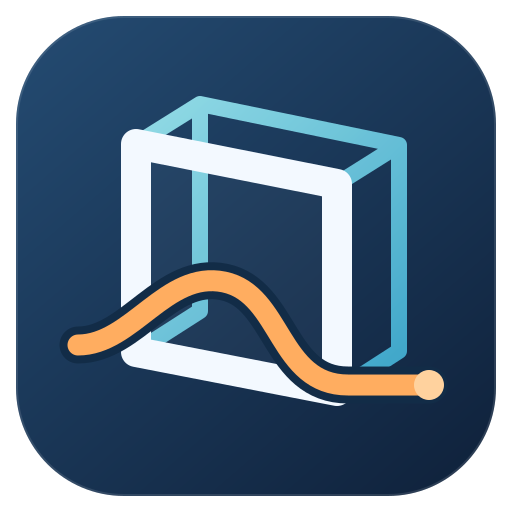
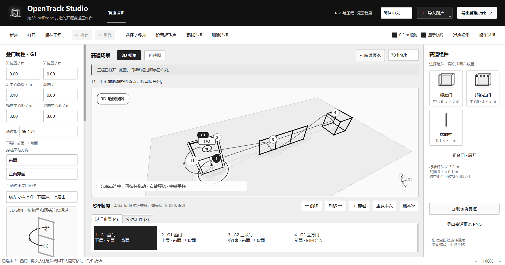

# OpenTrack Studio

[English](README.md) | 简体中文

**专门适配黑羊模拟器 VelociDrone 的开源 C++/Qt 赛道编辑器。** 导入赛道设计图可在本地自动生成草稿，核对三维路线后导出原生 .trk。

界面支持简体中文与 English，语言选择会保存在本机。任何人都可以 Fork、修改源码并提交 Pull Request，参见 [贡献指南](CONTRIBUTING.md)。许可范围和旧版授权说明见 [许可证说明](docs/licensing.md)。



用图片搭建 FPV 赛道的 C++ 桌面编辑器。**0.1.7 预览版**按路线与遮挡关系表达连续进出门：绕立柱的同时升降、进入另一层开口，或沿联门依次推进，不先回到原窗口再升高。实体与过门步骤分开，同一座门可多次穿越而不复制杆件。导入设计图生成草稿，在实际 3D 动作预览中核对入口、出口、换层和绕行侧，再导出 VelociDrone `.trk`。

**无需应用账号登录，工程保存在本机。** 平面图识别完全在本地运行；可选的实拍 AI 功能仅在点击“生成草稿”后，将选定照片发送到 DeepSeek 官方 API。界面、图标、示例赛道和实现代码独立编写，从 0.1.7 起源码采用 GPL-3.0-or-later 许可证。



先打开公开合成示例 [threading-demo.otproj](examples/threading-demo.otproj) 查看推进动作；示例与截图均不包含用户提供的原图。基础操作见 [快速上手](docs/quickstart.md)。

## 当前功能

- 黑白高对比界面，默认 3D 场景使用浅灰实体地面；来源图片只作为可选的 2D 参考，不铺在 3D 地面上。
- 把单张 PNG / JPG / BMP 拖到左侧小框、3D 场景或俯视图，自动在本地生成草稿；一次撤销恢复导入前的整个工程。
- 深蓝轮廓配洋红路线的设计图支持标准门、双联门、三联门、叠门、立方门和双层立方门；图例不计作障碍，可辨认的起飞平台单独处理。
- 可选实拍/航拍 AI 草稿：最多选择 8 张照片，补充已知门宽及起点、方向、门序说明，预览确认后再应用。
- 在场景中摆放、选择、拖动、旋转门架，调整尺寸和中心高度。
- 地面使用 X / Y 坐标，Z 向上。标准门及组合门每格横、竖中心距 3 m，杆长 3.2 m、截面 0.1 × 0.1 m；转向柱默认同截面、长 3.2 m。
- “实体组件”与“过门步骤”两个列表：实体标为 G1、G2，过门次数单独编号；重复穿门只增加步骤。
- 每次穿越可单独选择列、层、前后或立方体各面及反转方向。识别后默认选择“当前识别路线 · 连续绕杆”，3D 动作预览保留已识别的进出关系，选择本项不会重写路线。
- 手动动作提供绕左/右立柱上升或下降、绕中横杆换层、联门交替穿越及重力门俯冲/爬升；旧的闭环整圈动作另列为高级选项，不替代图中连续推进。
- 独立设置起飞架的位置、基点高度和朝向，起飞点不占过门编号，默认不创建降落点。
- 选中门架后显示属性；比例和底图高级设置默认收起。
- 3D 显示实际窗口、过门点、入口/出口箭头和绕行引导点；曲线使用孔内偏移及斜向飞行切线，按模型检查 0.20 m 预览净空。无法平滑连接会提示，无法安全连接则断开显示。
- 关键外侧 T 翻绕检查点随实际穿门顺序导出，用于约束绕行侧；普通拟合引导点留在工程中，不把所有采样点变成隐藏关卡。两者都不增加实体杆件。
- 将完整工程保存为 `.otproj`，底图随工程嵌入。
- 导入、导出 VelociDrone `.trk`；新建方梁标准门、起终点门、转向柱及上述组合门均支持导出。

本地识别面向清晰、平整且符合上述样式的设计图；简单蓝色图使用基础检测，不能保证还原复杂组合及门序。照片、透视图、其他配色或完整软件截图可能漏检、误检；建议先裁出赛道区域。真实高度、通过方向、交叉及重复穿门仍需校对。连续导入时以最后一次为准，识别期间的工程编辑不会被旧结果覆盖。第一次使用可先看 [快速上手](docs/quickstart.md)，更多设置见 [使用说明](docs/usage.md)。

识别结合路线箭头、可见线段与杆件遮挡关系推断进出、深度和升降，不因门型相同就补齐未经过的窗口或闭环整圈。正视图有足够遮挡证据时也可生成连续推进；线索不足、路线断裂或遮挡无法区分时才标记待校对。选中实体可直接检查当前识别路线的 3D 预览；手动选择其他模板并“应用动作”会替换该实体原有动作，可撤销。

孔内偏移和斜向切线描述的是预览过门点，不改变原生门框完整窗口的中心、大小和接受方向。`.otproj` 保留拟合轨迹与实体关联；`.trk` 只保存实际窗口及明确标记的关键 T 检查点，不能恢复全部预览采样。旧 [circle-demo.otproj](examples/circle-demo.otproj) 保留为高级闭环整圈示例，与推进示例分别使用。

0.20 m 净空是模型预览检查，不是试飞、动力学或比赛判定保证。保守绕行可能保留不连续的局部切向；出现警告后应调整组件或引导点，再在模拟器中验收。

实拍 AI 功能使用固定官方端点 `https://api.deepseek.com` 和 `deepseek-flash` 模型，需要用户自己的 API 密钥；可选择保存到 Windows 凭据管理器。拖入多张照片会打开 AI 窗口，只有明确点击生成才发送缩放后的照片，生成后先预览，再决定是否应用。默认勾选“快速生成”，复杂组合可取消后重试；两种模式都可能漏识或返回无效结果，没有固定耗时保证。结果需人工校对，不属于测绘或摄影测量重建。

## VelociDrone 兼容状态

项目包含独立实现的原生 `.trk` 读写。此前 C++ 兼容性测试赛道已通过安装版 VelociDrone 导入和场景载入；**完整试飞尚未完成。** F9 试飞因遥控器未配置而中止。0.1.6 的推进动作已做独立数值及几何回归，实际窗口触发、碰撞和全程飞行仍需验收。

原生检查点按模拟器本地 −X 接受方向写入。0.1.4 工程应核对箭头后重新导出；已有 `.trk` 不会自动更新。旧工程若误用了闭环整圈，不会被新版静默改成推进动作；请从原图重新生成，或明确选择推进模板后另存，并核对关键 T 检查点。

测试范围和官方 AI 接口实测记录见 [验证记录](docs/validation.md)。

导出文件后，可依照 [VelociDrone 官方手册](https://www.velocidrone.com/desktop_manual)，将文件放入 Windows“文档”目录，再在模拟器的 Track Editor 中使用 Import Track。编辑器不直接改写模拟器数据库，也不要求模拟器账号凭据。对象支持范围和格式依据见 [格式说明](docs/format.md)。

## 构建与测试

当前目标平台为 Windows x64。需要 Visual Studio 2022 的 C++ 桌面开发工具、CMake 和 Qt 6.8.3 的 MSVC 2022 x64 组件。原生 `.trk` 加解密使用 Windows BCrypt；应用运行时不需要 Python。

在仓库目录运行，替换 Qt 路径。以下将构建和运行包放在 D 盘；没有 D 盘时改用其他数据盘目录，源码及已安装 Qt 无需移动：

```powershell
cmake -S . -B D:/CodexWork/OpenTrackStudio/build -DCMAKE_PREFIX_PATH="C:/Qt/6.8.3/msvc2022_64"
cmake --build D:/CodexWork/OpenTrackStudio/build --config Release
ctest --test-dir D:/CodexWork/OpenTrackStudio/build -C Release --output-on-failure
```

发布 Windows 程序时，需使用对应 Qt 版本的 `windeployqt` 收集动态库和插件，并附带第三方许可说明。构建过程和 CI 使用 Python 下载 Qt 属于开发工具链，应用功能由 C++ 实现。参见 [Qt Windows 部署文档](https://doc.qt.io/qt-6/windows-deployment.html)。

也可使用项目提供的打包脚本；输出目录必须为新目录或空目录：

```powershell
./scripts/package.ps1 -QtDir "C:/Qt/6.8.3/msvc2022_64" -BuildDir D:/CodexWork/OpenTrackStudio/build -OutputDir D:/CodexOutputs/OpenTrackStudio-Windows
```

脚本会部署动态库、平台与图片插件、Windows Schannel TLS 插件、MSVC 可再分发运行库、使用文档和原始示例。Qt 的许可及第三方声明从官方 QtBase 6.8.3 源码归档中收集，下载内容会校验 SHA-256；已解压对应源码时可通过 `OPENTRACK_QTBASE_SOURCE` 环境变量复用。GitHub CI 在测试通过后生成便携 ZIP。

## 开源与贡献

应用及新增贡献从 0.1.7 起采用 [GPL-3.0-or-later](LICENSE)，分发受其覆盖的衍生软件时须提供对应源码；早期 MIT 声明按 [NOTICE](NOTICE) 保留。Qt 及其依赖保留各自许可证，见 [第三方说明](THIRD_PARTY_NOTICES.md)。项目不包含 VelociDrone 的模型、贴图、原程序代码或用户提供的参考截图，也不隶属于 VelociDrone。

欢迎提交可公开使用的赛道图、识别问题和模拟器导入结果。提交测试图片前，请确认有权公开它们；提供模拟器版本、场景和复现步骤有助于定位兼容问题。
