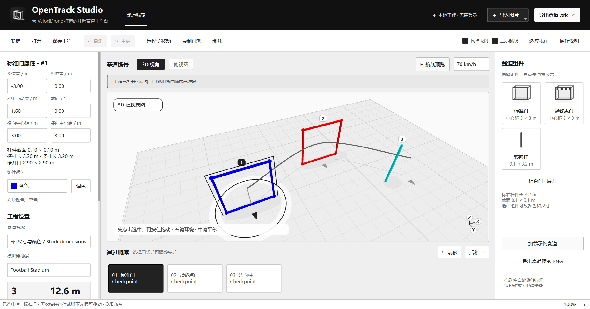

# 快速上手

OpenTrack Studio 0.1.4 第一次打开会显示示例赛道。无需应用账号登录。3D 使用浅灰实体地面；需要看原图时，切换俯视图并打开 2D 参考图显示。

## 先学会移动组件

1. **单击门架或转向柱，松开鼠标**，看到地面选中光圈。
2. 再按住这个组件，或按住它脚下的光圈拖动，即可调整平面位置。细柱较难点中时，可以点击它上方的编号，再拖光圈。
3. 在左侧属性中修改实体尺寸、Z 中心高度、朝向和颜色；**X / Y 是地面位置，Z 向上**。转向柱可选绕行侧。选择一次过门步骤后，可独立设置通过格、面和方向。

第一次按住尚未选中的组件，只完成选择；松开后再拖动。需要放新组件时，先点击右侧组件卡片，再点击场景放置，按 `Esc` 返回选择工具。

| 想做什么 | 操作 |
| --- | --- |
| 旋转 3D 视角 | 按住右键拖动，或拖动场景空白处 |
| 平移视角 | 中键拖动，或按住空格加左键拖动 |
| 缩放 | 滚轮 |
| 找回整条赛道 | 按 `F`，或点击“适应视角” |
| 平面定位 | 点击场景上方“俯视图” |
| 旋转选中组件 | `Q` / `E`，每次 15° |
| 复制 / 删除 | `Ctrl+D` / `Delete` |
| 撤销 / 重做 | `Ctrl+Z` / `Ctrl+Shift+Z` |

## 从图片生成赛道

**单张平面设计图：** 将 PNG / JPG / BMP 拖到左侧“拖入赛道图片”小框、3D 场景或俯视图，也可点击小框选图。程序自动在本机生成，不上传图片。深蓝轮廓配洋红路线的图支持识别组合门和路线顺序；简单蓝色图使用基础检测。先裁掉视频界面、字幕和组件库，生成后仍需检查漏检、门型和门序。

导入完成后，按一次 `Ctrl+Z` 可恢复导入前的底图和组件。连续拖图以最后一次为准；识别期间若修改工程，旧结果会被丢弃。

**实拍或航拍照片：** 一次拖入多张照片，或点击“AI 解析当前图 / 多张照片”，添加同一场地的 1–8 张照片，填写已知门宽和飞行顺序，设置自己的 DeepSeek API 密钥。打开窗口、选图都不会上传；点击“生成草稿”后才发送。默认勾选“快速生成”，耗时与准确率均无保证；检查预览后再应用。

已知门宽指左右立柱的中心距。新建标准门的横、竖中心距均为 **3 m**，四根杆各长 **3.2 m**、截面 **0.1 × 0.1 m**，净开口 **2.9 × 2.9 m**。杆件包含交叉重叠处和端部伸出部分。转向柱默认长 **3.2 m**，截面 **0.1 × 0.1 m**。

右侧展开“组合门”可放置双连、三连、日字、单层及双层重力门。组合门尺寸按**每格** 3 × 3 m 中心距计算。日字门和双层重力门贴地时，整个组件的 Z 中心高度为 3.1 m，单门及其余组合为 1.6 m。

## 生成后检查什么

- 位置、比例、高度和朝向：图片无法提供的尺寸会被估算。中心高度是组件中心离地的高度；上述标准门和转向柱贴地时，中心高度均为 1.6 m。选中标准门会显示中心距、杆长、截面和净开口。旧工程及导入的原生门保留各自的尺寸约定。
- 转向柱：选中柱子，在左侧选择“右侧绕过”或“左侧绕过”。左右以柱子的朝向为准；编辑器中 `0°` 朝地面平面的 `+Y`，`90°` 朝 `+X`。右下角坐标指示器的 Z 轴表示向上。
- 实体与过门次数：底部“实体组件”的 G1、G2 是实际门架；“过门步骤”的 1、2、3 是每次穿越。同一座门可出现多次，不必复制实体。
- 通过顺序：在“过门步骤”选择一次穿越，用“前移”“后移”调整；“重复本次”只增加穿越，“删本次”不删除门架。悬停 3D 数字可查看对应实体和穿越次数，底部步骤也显示实体关联。
- 组合门：选中步骤后，设置第几列、第几层、穿越面及方向。顶面默认向下穿入，反转后向上穿出；物理门架不会随穿越反向而转动。
- AI 草稿：可能少识别门架、漏掉组合或返回无效结果；应用前逐项检查，不把一次成功当作精度保证。

内部及模拟器的坐标转换由程序处理，旧工程的位置和朝向保持兼容。

## 日字、三连和重力门怎么校正

选中实体，在左侧“手动校正过门动作”中选择动作，再点“应用动作”：日字门可先下后上或先上后下绕行，联门可按列交替穿越，重力门可从顶部俯冲或从下部穿入再向上穿出。

这会替换该实体已有的全部过门动作，可撤销。生成的菱形引导点用于绕行，不占检查点编号。门型不决定飞法，仍需对照图上的路线和箭头，逐次检查实际窗口、方向与连线。

## 保存和导入黑羊模拟器

1. 核对独立起飞点；若尚未设置，点击“设置起飞点”或“在场景放置起飞点”，再点击地面放置 `T/O` 标记。展开“坐标与朝向”调整基点 Z 和朝向；基点是原生起飞架参考原点，实际无人机起飞位由模拟器决定。
2. 按 `Ctrl+S` 保存 **`.otproj` 工程**，再点击“导出赛道 .trk”。起飞点独立于第一个门，不占过门编号；默认不创建降落点。
3. 将 **`.trk` 赛道文件**放到 Windows“文档”目录，在 VelociDrone 的 **Track Editor → Import Track** 中导入。
4. 在模拟器中检查起飞位、尺寸、每次穿越的方向和地面高度，再试飞。测试文件已通过模拟器导入和场景载入，完整飞行及通过判定仍待验收。

更多设置见 [完整使用说明](usage.md)。
